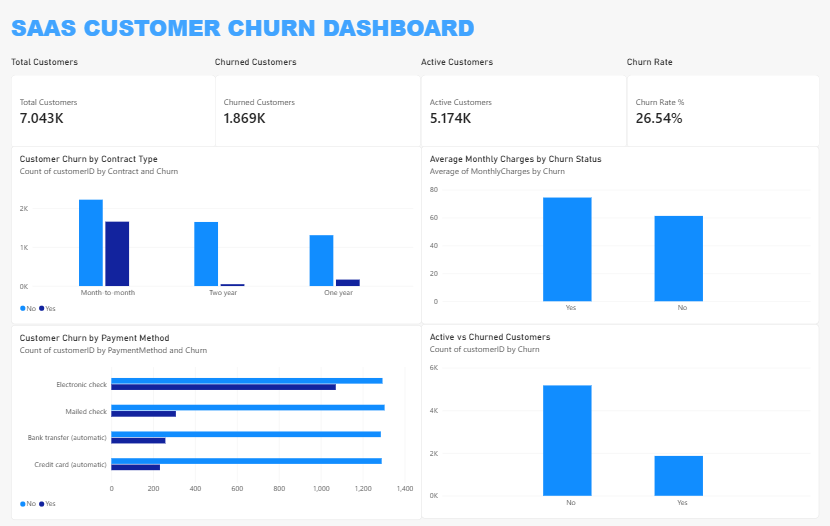

# SaaS Customer Churn Analysis

## Project Overview
This project analyzes customer churn in a SaaS-style customer dataset. It uses Python for data cleaning and churn risk scoring, SQL for data storage and querying, Excel for KPI analysis, and Power BI for interactive visualization.

## Objectives
- Analyze customer churn and retention.
- Calculate key customer KPIs.
- Compare churn across contract types and payment methods.
- Examine average monthly charges for customers who stayed and those who churned.
- Identify customer groups that may need improved retention strategies.

## Tools and Technologies
- Python
- Pandas
- MySQL
- Microsoft Excel
- Microsoft Power BI

## Project Workflow
1. Load and inspect the customer dataset.
2. Clean the data using Python.
3. Calculate rule-based churn risk scores.
4. Store the cleaned customer data in MySQL.
5. Prepare KPI analysis in Excel.
6. Build a Power BI dashboard to visualize customer churn patterns.

## Key Dashboard Visualizations
- Total Customers
- Churned Customers
- Active/Non-Churned Customers
- Churn Rate
- Customer Churn by Contract Type
- Average Monthly Charges by Churn Status
- Customer Churn by Payment Method

## Project Files
- `churn_analysis.py`: Initial analysis script
- `clean_and_score.py`: Data cleaning and risk scoring
- `requirements.txt`: Python dependencies
- `sql/`: SQL scripts and queries
- Power BI report: Interactive dashboard
- Excel report: KPI dashboard, if included

## Limitations
The dataset represents customer information at a point in time. The analysis identifies patterns in the available data; it does not establish the causes of churn or validate future churn predictions.

## Conclusion
This project demonstrates a customer churn analysis workflow using Python, SQL, Excel, and Power BI. The results can help businesses explore retention patterns and investigate areas for improving customer retention.
## 📊 Power BI Dashboard Preview

